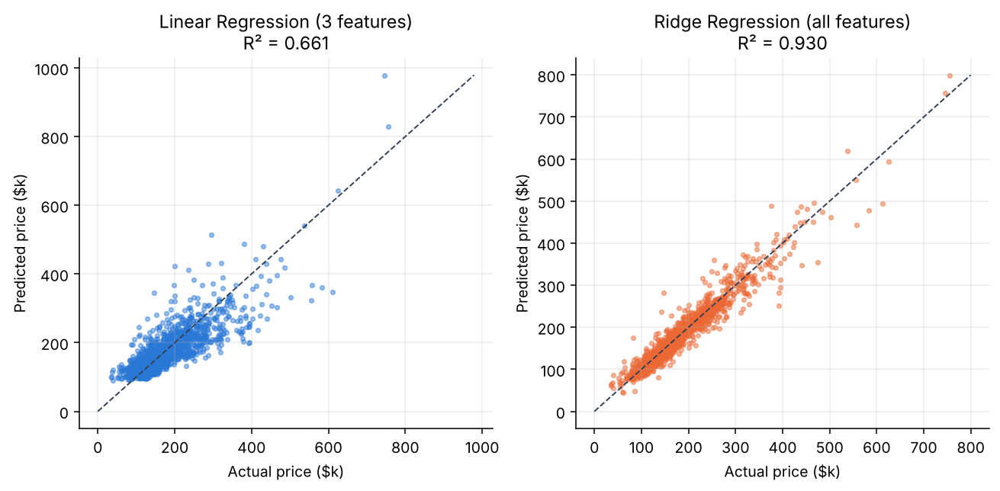

# 01 · House Price Prediction (Linear Regression)

Predict the sale price of a house from its living area, bedrooms and bathrooms, then measure how much a regularised linear model on all 79 features adds.

**Dataset:** [Kaggle – House Prices: Advanced Regression Techniques](https://www.kaggle.com/c/house-prices-advanced-regression-techniques/data) · 1,460 training homes (Ames, Iowa), 79 features

## Approach
1. Drop the 2 documented outliers (very large houses sold far below value).
2. Engineer `TotalBath` (full + ½ half baths, including basement) and `TotalSF`.
3. Model `log(SalePrice)`, because prices are right-skewed.
4. Compare three models under the **same 5-fold cross-validation**:
   - Linear Regression on the 3 task features
   - Ridge Regression (L2, α tuned by `RidgeCV`) on all features, with median imputation, scaling and one-hot encoding inside a `Pipeline`
   - Gradient Boosting on all features, as a non-linear reference

## Results (5-fold CV)

| Model | R² | MAE | RMSE | RMSE (log) |
|---|---|---|---|---|
| Linear Regression (3 features) | 0.661 | $31,871 | $46,277 | 0.237 |
| **Ridge Regression (all features)** | **0.930** | **$13,981** | **$21,048** | **0.116** |
| Gradient Boosting (all features) | 0.923 | $14,083 | $22,127 | 0.116 |

The regularised linear model matches gradient boosting. `results/submission.csv` is a ready Kaggle submission.



## Run
```bash
python train.py --data ../data/house-prices
```
