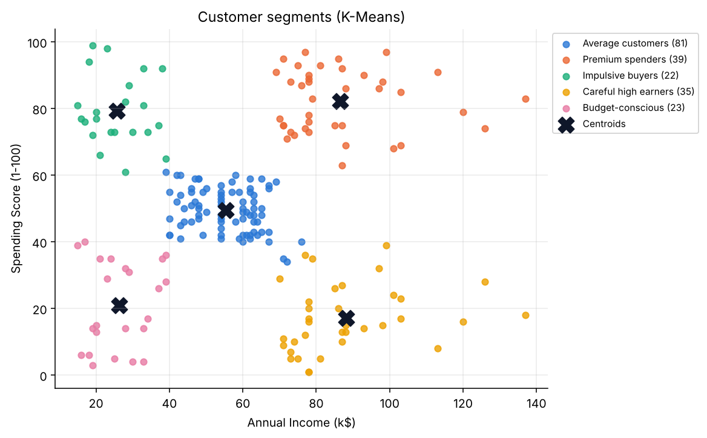

# 02 · Customer Segmentation (K-Means)

Group retail customers by purchasing behaviour so marketing can target each segment differently.

**Dataset:** [Kaggle – Mall Customer Segmentation](https://www.kaggle.com/datasets/vjchoudhary7/customer-segmentation-tutorial-in-python) · 200 customers (gender, age, annual income, spending score)

## Approach
- Standardise annual income and spending score, the two behavioural features.
- Run K-Means for k = 2…10 (20 initialisations each). Choose **k by silhouette score**, cross-checked with the elbow (inertia) and the Davies-Bouldin index.
- Profile each cluster (size, average income/spending/age, % female) and give it a business label.

## Results
k = **5** (silhouette **0.555**, Davies-Bouldin **0.572**)

| Segment | Customers | Avg income | Avg spending |
|---|---|---|---|
| Average customers | 81 | $55k | 50 |
| Premium spenders | 39 | $87k | 82 |
| Careful high earners | 35 | $88k | 17 |
| Budget-conscious | 23 | $26k | 21 |
| Impulsive buyers | 22 | $26k | 79 |



Outputs: `results/clustered_customers.csv` (every customer with its segment) and `results/segment_profiles.csv`.

## Run
```bash
python train.py --data ../data/mall-customers
```
