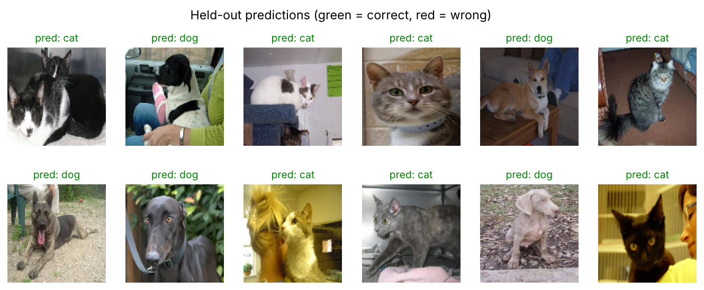

# 03 · Cats vs Dogs Classification (SVM)

Classify photos as cat or dog with a Support Vector Machine, without deep learning.

**Dataset:** [Kaggle – Dogs vs. Cats](https://www.kaggle.com/c/dogs-vs-cats/data) · 25,000 labelled images (balanced) + 12,500 unlabelled test images

## Approach
| | Baseline | Final model |
|---|---|---|
| Input | 32×32 grayscale pixels | 64×64 colour image |
| Features | raw pixels → PCA (95% variance) | **HOG** (edges/shape, 1,764-d) + **HSV colour histogram** (96-d) → PCA 300 |
| Classifier | Linear SVM | **RBF-kernel SVM**, C and γ tuned with 3-fold `GridSearchCV` |

Stratified 80/20 split: 20,000 training and 5,000 test images. Feature extraction runs in parallel and is cached.

## Results (5,000 held-out images)

| Model | Accuracy | ROC AUC |
|---|---|---|
| Raw pixels + PCA + Linear SVM | 57.0% | – |
| **HOG + colour + RBF SVM** | **80.7%** | **0.895** |



`results/test_predictions.csv` holds predictions for the 12,500 unlabelled Kaggle test images (1 = dog).

## Run
```bash
python train.py --data ../data/dogs-vs-cats   # ~6 min on a laptop CPU
```
