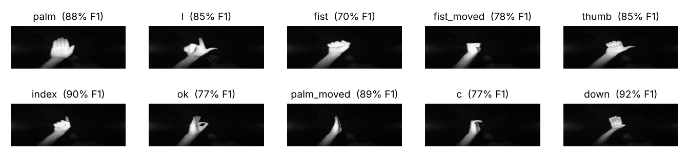
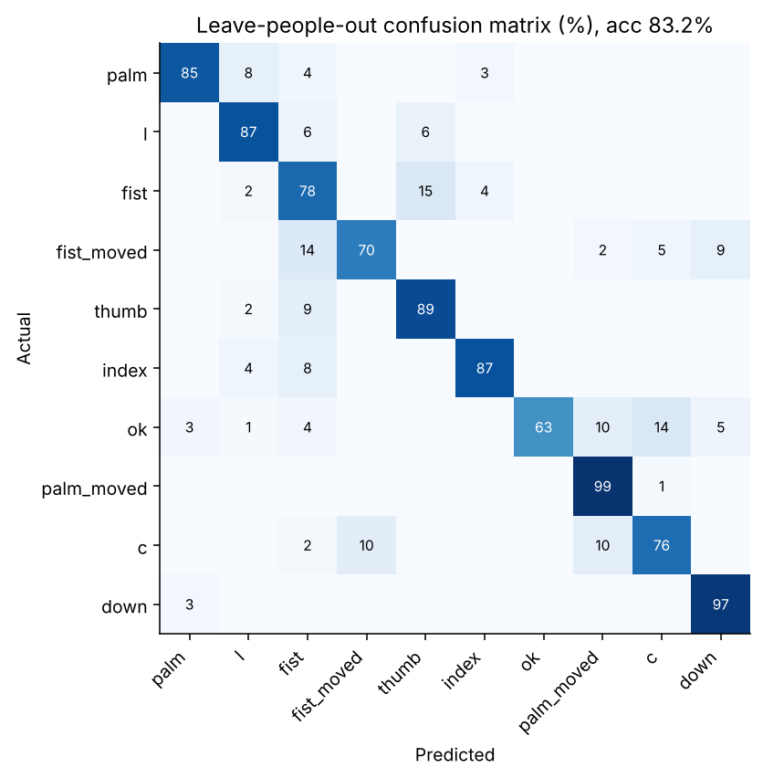

# 04 · Hand Gesture Recognition

Recognise 10 hand gestures from near-infrared images for touch-free, gesture-based control.

**Dataset:** [Kaggle – LeapGestRecog](https://www.kaggle.com/datasets/gti-upm/leapgestrecog) · 20,000 images = 10 people × 10 gestures × 200 frames
Gestures: palm, L, fist, fist moved, thumb, index, OK, palm moved, C, down

## Approach
1. **Hand crop:** Otsu threshold on the IR frame → bounding box of the bright hand → square crop. This removes position and scale differences.
2. 64×64 → histogram equalisation → **HOG** descriptor (1,764-d) → PCA 150 → **RBF SVM**.
3. **Leave-people-out evaluation** (`GroupKFold`, 5 folds × 2 unseen people). A gesture interface has to work for new users, so random splits are misleading here.

## Results

| Setup | Accuracy |
|---|---|
| Random split (same people in train and test) | 100.0% ← leakage |
| Unseen people, full frame | 68.9% |
| **Unseen people, hand crop** | **83.2%** (macro F1 0.831) |




## Files
- `train.py`: CPU pipeline above; saves `results/gesture_svm.joblib`
- `predict_webcam.py`: single-image or webcam prediction with the saved model (experimental: trained on infrared frames, so ordinary webcam footage will be less accurate)
- `gesture_cnn_gpu.ipynb`: Keras CNN with the same leave-people-out split, ready for Kaggle/Colab GPU

## Run
```bash
python train.py --data ../data/leapgestrecog
python predict_webcam.py            # press q to quit
```
