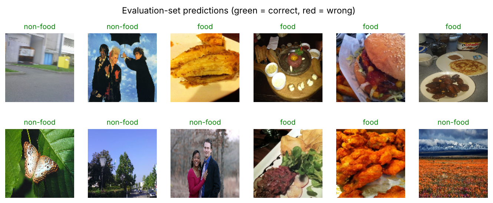

# 05 · Food Recognition & Calorie Estimation

Recognise food in a photo and estimate its calories, for automated dietary tracking.

```
photo ──► [1] food detector ──► [2] dish classifier ──► [3] calorie lookup ──► "pizza · 272 kcal / slice"
          Food-5K, SVM (CPU)      Food-101, CNN (GPU)       541-food nutrition table
```

**Datasets:** [Food-5K](https://www.kaggle.com/datasets/trolukovich/food5k-image-dataset) (2,500 food + 2,500 non-food) · [Food-101](https://www.kaggle.com/datasets/dansbecker/food-101) (101 dishes × 1,000 images) · `assets/food_calories.csv`

## Stage 1 · Food detector (`train.py`)
HOG shape (4,356-d) + HSV colour histogram (192-d) + LBP texture (10-d) → PCA 250 → RBF SVM. Hyper-parameters are tuned on the official *validation* split and the score is reported once on the untouched *evaluation* split.

| Metric (1,000 evaluation images) | Value |
|---|---|
| Accuracy | **89.0%** |
| ROC AUC | **0.954** |
| Food precision / recall | 0.89 / 0.89 |



## Stage 2 · Dish classifier (`food101_cnn_gpu.ipynb`)
EfficientNetB0 (ImageNet) transfer learning on Food-101: a frozen-backbone head first, then fine-tuning of the top layers. It returns the top-3 dishes with calories. Run it on Colab/Kaggle with a GPU.

## Stage 3 · Calorie lookup (`calories.py`)
- Parses `"272 cal"` → 272 and `"1 slice (102 g)"` → 102 g, then computes **kcal per 100 g**. Removes duplicate foods (541 left).
- Matches names strictly: exact name → all words contained → near-identical spelling, plus hand-checked overrides. A wrong calorie value is worse than none, so ambiguous names return `None`.
- 34 of the 101 Food-101 dishes have a verified match. Extending the table is the main next step.

```python
from calories import lookup
lookup("french_fries")  # {'matched': 'French Fries', 'kcal_per_serving': 222.0, 'serving': '1 serving (71 g)', 'kcal_per_100g': 312.7, ...}
```

## Run
```bash
python train.py --data ../data/food-5k
python calories.py
```
